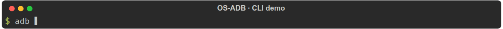
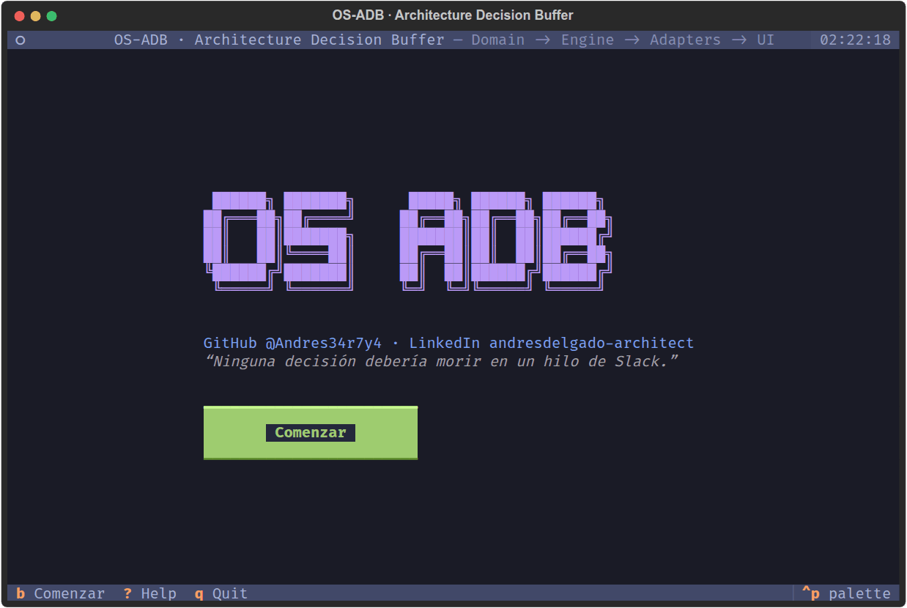
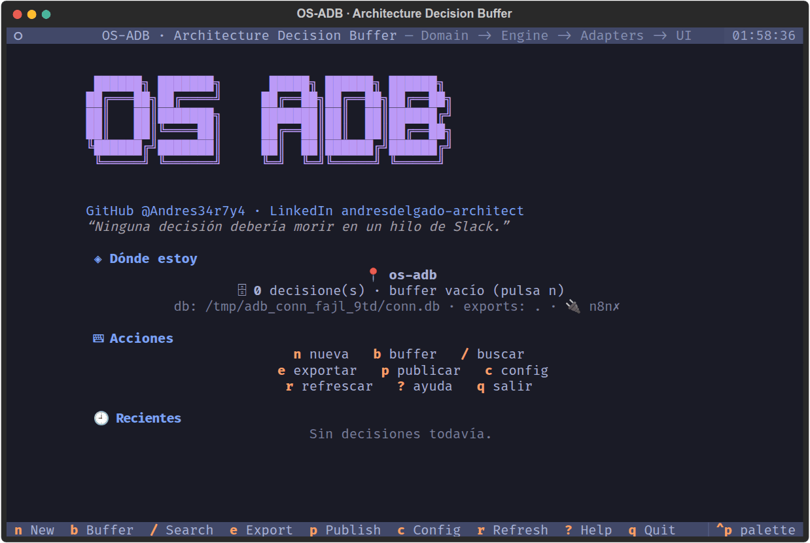
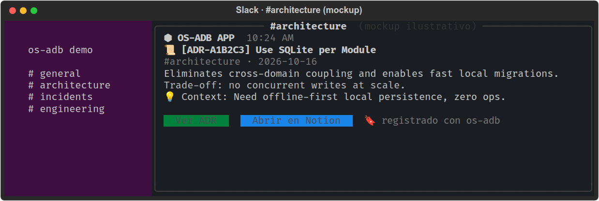

# 🛠️ OS-ADB: Architecture Decision Buffer

```text
 ██████╗ ███████╗      █████╗ ██████╗ ██████╗
██╔═══██╗██╔════╝     ██╔══██╗██╔══██╗██╔══██╗
██║   ██║███████╗     ███████║██║  ██║██████╔╝
██║   ██║╚════██║     ██╔══██║██║  ██║██╔══██╗
╚██████╔╝███████║     ██║  ██║██████╔╝██████╔╝
 ╚═════╝ ╚══════╝     ╚═╝  ╚═╝╚═════╝ ╚═════╝
```

> *“Ninguna decisión debería morir en un hilo de Slack.”*

[](https://github.com/Andres34r7y4/os-adb/actions)
[](LICENSE)
[](https://www.python.org/)
[](https://www.linkedin.com/in/andresdelgado-architect/)

> **Perdí 3 horas discutiendo por qué usamos Postgres… nadie recordaba la decisión. OS-ADB existe para que eso no te pase.**
> Registra decisiones de arquitectura (ADRs) en **2 segundos sin salir de la terminal.**

## 🎬 Demo

| CLI en 2 segundos | Tour TUI | Conectores (test en vivo) |
|---|---|---|
|  |  |  |

Así llega un ADR a Slack (mockup ilustrativo):



> Regenerables con `python docs/demo/generate_gifs.py` (headless, determinista).

```bash
adb add --title "Use SQLite per Module" --justification "Zero ops, git-friendly" --tag "architecture"
```

---

## ⚡ Quickstart (30 segundos)

```bash
git clone https://github.com/Andres34r7y4/os-adb.git
cd os-adb
make install        # crea .venv e instala todo
# o: bash install.sh

adb seed            # carga 3 decisiones de ejemplo
adb list            # tabla bonita con Rich
adb show ADR-XXXXXX
adb search --tag architecture
adb export          # -> ./ADR_LOG.md (o tu export_dir)
adb                 # modo TUI interactivo (Textual)
```

Sin `make`:

```bash
python3 -m venv .venv && source .venv/bin/activate
pip install -e ".[dev]"
```

## 💻 Modos

| Modo | Comando | Stack |
|------|---------|-------|
| CLI rápida | `adb add/list/show/search/export/delete/publish (--dry-run)/webhook ping/config/about` | Typer + Rich |
| TUI interactiva | `adb` → **Home** (logo, contexto, recientes) → `b` Buffer | Textual (screens + modales) |

### 🏠 Home (página de inicio)

Al abrir `adb` aterrizas en la Home: logo, redes, tagline y botón **Comenzar**.
`b`/`enter` entran al Buffer, `esc` vuelve.

> La base vive en `~/.adb/adr_buffer.db` (igual desde cualquier carpeta).
> Override: `ADB_DB=/tmp/demo.db adb list`. Legacy: si existe `./adr_buffer.db` se sigue usando.

### ⌨️ Atajos TUI

| Tecla | Acción |
|-------|--------|
| `n` | Nueva decisión (modal con validación) |
| `b` / `esc` | Ir al Buffer / volver a Home |
| `d` | Eliminar seleccionada (pide confirmación) |
| `/` | Foco en filtro (título/tag/justificación, en vivo) |
| `enter` | Ver detalle en el inspector |
| `p` | Publicar seleccionada (conector activo) |
| `c` | Configuración (db, exports, conectores) + botón Test |
| `e` | Exportar `ADR_LOG.md` |
| `r` | Refrescar |
| `q` | Salir |
| `?` | Ayuda: logo, redes, atajos y ritual (también `adb about`) |

Tema visual: `tokyo-night` por defecto (sin hex hardcodeado, todo con variables
del theme). Cambialo con `ADB_THEME=catppuccin-mocha adb` (cualquiera de
`adb` + `Textual`: `dracula`, `nord`, `rose-pine`, `gruvbox`…).

Ejemplo salida `list`:

```text
📜 Architecture Decision Buffer
┏━━━━━━━━━━━━┳━━━━━━━━━━━━━━━━━━━━━┳━━━━━━━━━━━━━━━┳━━━━━━━━━━━━━━━━━━━━━━┓
┃ ID         ┃ Date                ┃ Tag           ┃ Title                ┃
┡━━━━━━━━━━━━╇━━━━━━━━━━━━━━━━━━━━━╇━━━━━━━━━━━━━━━╇━━━━━━━━━━━━━━━━━━━━━━┩
│ ADR-A1B2C3 │ 2026-10-16 00:00:00 │ #architecture │ Use SQLite per Module│
└────────────┴─────────────────────┴───────────────┴──────────────────────┘
```

Ejemplo `ADR_LOG.md` generado:

```markdown
## [ADR-A1B2C3] Use SQLite per Module
- **Date:** `2026-10-16 00:00:00` | **Tag:** `#architecture`

### 💡 Context
Need offline-first persistence without ops overhead.

### ⚖️ Justification & Trade-offs
Eliminates cross-domain coupling. Trade-off: no concurrent writes at scale.
```

## 🟢 Por qué importa

| Antes | Con OS-ADB |
|-------|------------|
| ADRs en Slack/PRs que se pierden | SQLite local + Markdown versionable en git |
| Abrir Notion/Confluence rompe el flow | 1 comando, <2s, offline |
| "¿Por qué decidimos X?" sin respuesta | `search --tag` + `show` + `ADR_LOG.md` auditable |

**Deuda de decisión es deuda técnica silenciosa.** Cada ADR no registrado te cuesta horas de re-discusión en 6 meses.

## 🏗️ Arquitectura: Strict Layered Pattern

Ejemplo vivo de capas desacopladas, no solo una tool:

```text
┌─────────────────────────────────────────────┐
│ 🖥️ UI (cli.py, home/buffer screens, dialogs)│  Typer / Textual, thin
└──────────────────────┬──────────────────────┘
                       ▼
┌─────────────────────────────────────────────┐
│ ⚡ ENGINE (adr_service, settings, context)   │  Casos de uso + export MD
└──────────────────────┬──────────────────────┘
                       ▼
┌─────────────────────────────────────────────┐
│ 🧩 DOMAIN (models + ports)                   │  Entidad pura + Protocolos
└─────────────────────────────────────────────┘
                       ▲ usa vía inyección
┌─────────────────────────────────────────────┐
│ 🔌 ADAPTERS (sqlalchemy_repo, publishers)    │  SQLAlchemy + n8n/slack/notion
└─────────────────────────────────────────────┘
```

* `Domain` no importa nada externo. `Engine` depende del puerto `DecisionRepository` (`domain/ports.py`), no del ORM. Cambiar SQLite por Postgres = 1 adapter nuevo, 0 cambios en UI/Engine. Cero SQL crudo: todo via SQLAlchemy 2.0 dentro de `adapters/`.

## ⚙️ Configuración

Vive en `~/.adb/config.toml` (editable con `adb config` o tecla `c` en la TUI):

| Key | Default | Env override |
|-----|---------|--------------|
| `db_path` | `~/.adb/adr_buffer.db` | `ADB_DB` |
| `export_dir` | `.` | `ADB_EXPORT_DIR` |
| `publisher` | `n8n` | `ADB_PUBLISHER` |
| `webhook_url` | `""` | `ADB_WEBHOOK_URL` |
| `webhook_enabled` | `false` | `ADB_WEBHOOK_ENABLED` |
| `webhook_secret` | `""` | `ADB_WEBHOOK_SECRET` |
| `slack_webhook_url` | `""` | `ADB_SLACK_WEBHOOK_URL` |
| `notion_token` | `""` | `ADB_NOTION_TOKEN` |
| `notion_database_id` | `""` | `ADB_NOTION_DATABASE_ID` |

```bash
adb config show                              # columna default/custom
adb config set export_dir ~/docs/adrs
adb config set db_path ./local/adr.db       # la TUI recarga al instante
adb config set publisher slack              # n8n | slack | notion
```

## 🔌 Conectores: n8n, Slack y Notion

Tres conectores funcionales tras el puerto `Publisher`, sin SDKs
([guía 5-minutos + troubleshooting](docs/n8n_workflow.md)):

```bash
adb publish ADR-A1B2C3 --dry-run   # ve el payload exacto, sin red
adb webhook ping                   # valida el conector activo
adb publish ADR-A1B2C3             # o `adb add ... --publish`, o tecla `p` en TUI
```

## 🗺️ Roadmap

- [x] CLI `add/list/show/search/export/delete/publish (--dry-run)/webhook ping/config/about`
- [x] TUI Home + Buffer + alta + delete + filtro + config(+Test) + publish + ayuda centrada (38 tests) + CI
- [x] ORM SQLAlchemy + puertos + settings TOML + 3 conectores funcionales (n8n/slack/notion)
- [ ] Adapter Postgres + `export --format json`
- [ ] `adb edit` / tags múltiples

## 🙌 Comunidad y seguridad

- **Contribuir:** lee [`CONTRIBUTING.md`](CONTRIBUTING.md) y elige una idea en [`docs/ideas-para-contribuir.md`](docs/ideas-para-contribuir.md) (niveles 🟢🟡🔴).
- **Conducta:** [`CODE_OF_CONDUCT.md`](CODE_OF_CONDUCT.md).
- **Seguridad:** reportes privados según [`SECURITY.md`](SECURITY.md) (no abras issues públicos).

## 👤 Autor

**Andrés Delgado** — Architect & Systems Factory Engineer
- LinkedIn: [andresdelgado-architect](https://www.linkedin.com/in/andresdelgado-architect/)
- GitHub: [@Andres34r7y4](https://github.com/Andres34r7y4)

## 📄 Licencia

MIT. Ver [LICENSE](LICENSE).
